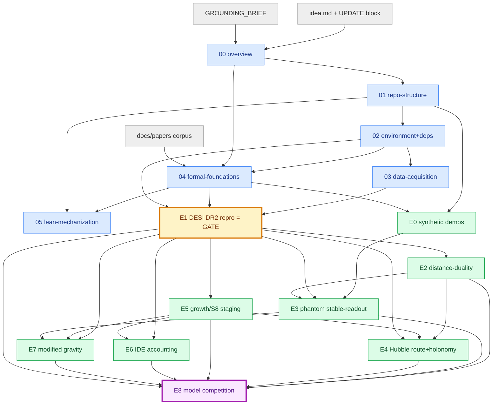

# Plan 08 — Dependency DAG and Execution Sequencing

> **Status:** PLANNING / BLUEPRINT. This file is the **execution-order contract** for the Six Birds
> dark-energy-as-closure (SBT-DE) program. It does **not** run anything. It is consumed by the later
> codex-driven execution process to decide *what runs when, what blocks what, and what may run
> concurrently*. Everything here is derived from the `blocks` / `blockedBy` relations declared in the
> sibling plan files (00–07 and `experiments/E0–E8`) and is consistent with `GROUNDING_BRIEF.md`
> and `idea.md` (including the UPDATE block on the Hubble readout field / holonomy / lawful plurality).
>
> **Authoritative cross-references.** The dependency edges asserted below are exactly the edges
> declared in the per-file `blockedBy` lists. Where this file and a sibling disagree, the sibling's
> `blockedBy` wins and this DAG must be corrected. The pass/fail thresholds referenced here are owned
> by the per-experiment files (`plan/experiments/E#.md` §gates) and by `plan/00-overview.md` §6; this
> file owns only **ordering, gating, parallelism, and the critical path**.
>
> **Hard execution constraint (from the task brief).** Later execution is **sequential per track**,
> with **at most 3 tracks running in parallel**, and only for *genuinely independent* work (no shared
> mutable artifact, no `blockedBy` edge between them). When in doubt, serialize.

---

## 1. Two kinds of nodes

The DAG has two node classes; both must be respected by the scheduler.

1. **Foundation / scaffold nodes (F-layer).** The plan files 01–07 and the Lean track. These produce
   the package skeleton, environment, data, the locked math, the Lean targets, and (07, if present)
   the CI/test harness. They are *enabling artifacts*: an experiment cannot start until its foundation
   inputs exist. They are authored as plans already; "execution" of them means *materializing* the
   repo skeleton, environment, loaders, and `sbt_cosmo/` carriers.
2. **Experiment nodes (E-layer).** E0–E8. These consume the foundation artifacts and each other's
   committed outputs (coherence ledger, fitted `Ξ_cosmo` amplitudes, baselines). The single low-rank
   real-data `Ξ_cosmo` is fit in **exactly the coherence members E1–E7** (REGISTRY §3), whose
   amplitudes enter `results/xi_cosmo_coherence.csv`; **E0 is excluded** (it fits a synthetic
   `XiToy`, not `Ξ_cosmo`) and **E8 is the judge, not a member** (it consumes the frozen ledger and
   never re-fits).

The decisive ordering principle from `plan/00-overview.md` §0 and §6.1:

> **Reproduce before you reinterpret, and prove the foundation before you reproduce.**
> Nothing in the E-layer touches `Ξ_cosmo` until the foundation exists; no real-data `Ξ_cosmo` is
> *added* to any experiment until that experiment's published baseline is reproduced; **no real-data
> `Ξ_cosmo` object is fit anywhere in the program until the E1 reproduction gate (E1-A) passes.**
> This rule constrains the *real-data* `Ξ_cosmo` only (REGISTRY §6); it does **not** constrain E0's
> *synthetic, injected* `XiToy`, which E0 may fit/recover before E1.

---

## 2. The dependency edges (verbatim from the `blockedBy` lists)

### 2.1 Foundation layer (internal order)

| Node | Depends on (must exist first) |
|---|---|
| `00-overview` | `idea.md`, `GROUNDING_BRIEF` (read-only references) |
| `01-repo-structure` | `GROUNDING_BRIEF`, `idea.md` |
| `02-environment-and-deps` | `GROUNDING_BRIEF`, `idea.md`, corpus papers |
| `03-data-acquisition` | `GROUNDING_BRIEF`, `01`, `02`, `idea.md` |
| `04-formal-foundations` | `idea.md`, `00`, `GROUNDING_BRIEF`, `01`, `02`, corpus |
| `05-lean-mechanization` | `01`, `02`, `00`, `GROUNDING_BRIEF`, `idea.md`, (soft: the `sbt_cosmo` carriers for gate L8) |
| `06-…` / `07-…` (CI/test harness, if authored) | `01`, `02` |

So the foundation **linearizes** as:

```
00  →  01  →  02  →  03            (data track)
                 └→  04  →  05      (math track, then Lean track)
```

`01` and `02` are the gate for everything; `03` (data) and `04` (math) are siblings that both depend
on `01`+`02`; `05` (Lean) depends on `04` and structurally aligns to the `sbt_cosmo` carriers.

### 2.2 Experiment layer (the E-DAG)

Edges below are taken **directly** from each experiment file's `blockedBy`. Foundation prerequisites
(`01`–`05`, `03` loaders) are implicit for *every* E-node and are not repeated as edges in the graph;
only the **E→E and E→F-math** edges that drive scheduling are listed.

| Node | `blockedBy` (experiment-layer edges that gate scheduling) | Foundation inputs (implicit) |
|---|---|---|
| **E0** | — (data-free; fits a *synthetic injected* `XiToy`, not the real-data `Ξ_cosmo`; only needs the package skeleton + P4 statement) | `01`, `02`, `04` (P4), `05` (RouteMismatch/stability anchor, optional) |
| **E1** | — (first real-data node; the program gate) | `01`, `02`, `03`, `04` (kernels for E1-B), `00` |
| **E2** | **E1** | `03`, `02`, `04` |
| **E3** | **E0**, **E1**, **E2** | `03`, `02`, `04`, `05` (T5) |
| **E4** | **E1**, **E2**, **E5** | `04`, `03`, `GROUNDING_BRIEF` |
| **E5** | **E1** (E1-B coherence ledger); soft: **E2**, **E3** | `03`, `02` (CCL/pyccl `G-ENV-4` gate), `04` |
| **E6** | **E1**, **E5** | `04`, `03`, `02`, `01`, `05` |
| **E7** | **E1**, **E5**, **E3** | `03`, `02` (`G-ENV-4` gate), `04` |
| **E8** | **E1, E2, E3, E4, E5, E6, E7** + coherence ledger | `03`, `02`, `04` |

> **Edge sanity check against `blocks` lists (consistency, not new information):**
> E0 `blocks` {E1, E3, E4, E8}; E1 `blocks` {E2,E3,E4,E5,E6,E7,E8}; E2 `blocks` {E3,E8} (+E4/E5 via
> coherence ledger); E3 `blocks` {E7,E8}; E5 `blocks` {E4,E6,E7,E8}; E4 `blocks` {E8}; E6 `blocks`
> {E7-pairing,E8}; E7 `blocks` {E4 via M_ST comparator, E8}; E8 `blocks` the program verdict. Every
> `blocks` edge has a matching `blockedBy` edge in the table above. **No cycles.** (E7↔E3, E4↔E7,
> E6↔E7 are one-directional artifact-feeds, verified below in §6.)

---

## 3. The DAG (Mermaid)



### 3.1 ASCII rendering (for terminals without Mermaid)

```
            idea.md / GROUNDING_BRIEF / corpus
                         |
                        00
                         |
                        01 ----------------+
                         |                 |
                        02 ------+         |
                       /   \      \        |
                     03     04     \       |
                       \    | \     \      |
                        \   |  \---> 05 <--+      (Lean track; aligns to sbt_cosmo carriers)
                         \  |
   ============== FOUNDATION COMPLETE (01,02,03,04 materialized) ==============
                          |
            +-------------+--------------------------------+
            |                                              |
           E0  (data-free; can start once 01,02,04 ready)  |
            |                                              |
            |                  +---- E1  (THE GATE: reproduce DESI DR2 before any Xi) ----+
            |                  |          (needs 03 data + 02 stack + 04 kernels)         |
            |                  |                                                          |
            |        +---------+---------+---------+---------+                            |
            |        |         |         |         |         |                            |
            |       E2        E5    (E1-B coherence ledger feeds E5)                      |
            |        |         |                                                          |
            |        |         +----+----------+--------------+                           |
            |        |              |          |              |                           |
            +--->   E3 <------------+         E6             E7 <----- E3, E5             |
                     |   (E0,E1,E2)        (E1,E5)        (E1,E5,E3)                       |
                     |                                                                    |
                    E4 <---- E1, E2, E5   (route matrix + Hubble holonomy)                |
                     |                                                                    |
                     +------------------------+-------------------------------------------+
                                              |
                                             E8   (model competition: needs E1..E7)
                                              |
                                       PROGRAM VERDICT
                                   (coherence gate make-or-break)
```

> Reading aid: an arrow `A --> B` means "B is blocked by A; A must reach a terminal-accepted state
> (`PASS` or the honest-negative `ACCEPTED_NEGATIVE`; see §9) before B starts." The E1 box is drawn
> with emphasis because **its reproduction sub-gate (E1-A) is the program-wide gate**: no *real-data*
> `Ξ_cosmo` object may be fit anywhere — not in any E1-B…E8 — until E1-A passes. E0's *synthetic*
> `XiToy` is exempt (REGISTRY §6): fitting `XiToy` does not violate this rule
> (`plan/experiments/E1` gate `BLOCKING`; `plan/00` §0, §6.1).

---

## 4. The critical path

The **longest dependency chain** (the path that sets the minimum wall-clock if everything else is
perfectly parallel) is:

```
01 → 02 → 03 → E1(-A repro, then -B) → E5 → {E4 or E6 or E7} → E8
```

Two equal-length experiment-layer critical sub-paths share the same length-4 tail after E1:

- **Hubble pillar path:** `E1 → E5 → E4 → E8` (E4 needs E5 for the residual-reuse gate `G-E4-T4`, and E1+E2)
- **Repair-chart path:** `E1 → E5 → E7 → E8` (E7 also needs E3) and `E1 → E5 → E6 → E8`

Because **E5 sits on the critical path of E4, E6, and E7 simultaneously**, E5 is the single most
schedule-sensitive experiment. It is also the most compute-heavy after E8 (full CCL/pyccl 3×2pt
forward model, see `GROUNDING_BRIEF §IV`). **Scheduling priority: get E1 then E5 done early.**

Critical-path nodes (any delay here delays the whole program), in order:

1. `01` (repo skeleton) — enabling, cheap
2. `02` (environment, CLASS/CAMB/pyccl/cobaya/PolyChord, the `G-ENV-2` backend-agreement and `G-ENV-4` pyccl↔CLASS gates) — enabling, medium
3. `03` (data acquisition + loaders + checksums) — enabling, medium
4. **E1** — DESI DR2 reproduction (the gate) + first geometry `Ξ` (E1-B). Compute: w0wa scan, 12–24 h class.
5. **E5** — growth/staging with real CCL backend (most expensive non-E8 experiment).
6. **E4 / E6 / E7** — the heaviest of these sets the tail length (E4 holonomy + lawful-plurality is
   the canonical critical tail, being the central UPDATE-block pillar).
7. **E8** — model competition + PolyChord evidence over 6 contenders (the most expensive single node,
   `GROUNDING_BRIEF §IV` 40–100× baseline).

Off-critical-path (slack available): **E0** (data-free, ~2 h), **E2** (SN/BAO CDDR, light), the
**Lean track 05** (minutes; only gates E3's `G-E3-LEAN` and E8's stable-readout certificate column).

---

## 5. Phase plan (sequential phases; ≤3 parallel tracks within a phase)

Each phase below is a **barrier**: a phase may not begin until the prior phase's gating outputs are
committed and in a **terminal-accepted** state — `{PASS, ACCEPTED_NEGATIVE}` (REGISTRY §2) — i.e.
`PASS` or a pre-registered statused honest negative that the downstream node tolerates.
Within a phase, the listed tracks are *genuinely independent* (no `blockedBy` edge, no shared mutable
artifact) and may run concurrently up to the **3-track** cap.

### Phase 0 — Foundation materialization (no experiments)

**Goal:** stand up the repo, environment, data, math, and Lean scaffolds.

| Track | Work | Gate to exit |
|---|---|---|
| T-A | Materialize `01` skeleton; install `02` env; **`G-ENV-2` backend-agreement** (CLASS vs CAMB ≤0.1% on D_M/r_d, D_H/r_d; ≤0.2% on C_ℓ^TT) | `01` `G-REPO-1`; `02` `G-ENV-1`–`G-ENV-9` |
| T-B | Materialize `03` loaders + manifests + checksums; **G-DATA-1..9** | `03` data gates (covariance PD, catalog complete, route-tagged) |
| T-C | Lock `04` math (carrier, four residuals, ansatz, kernels, P1–P4); stand up `05` Lean targets T1–T7 | `04` Schur sanity + kernel linearity; `05` L1 build green |

> All three tracks here are independent (env vs data vs math) — **3-way parallel is allowed**.
> **Barrier:** none of E0–E8 starts until Phase 0 exits. (E0 needs `01`+`02`+`04`; E1 needs all four
> foundations; CCL-dependent E5/E6/E7 need `02`'s `G-ENV-4` pyccl↔CLASS gate green.)

### Phase 1 — Sanity layer + the program gate

**Goal:** the data-free demonstrations and the make-or-break reproduction gate.

| Track | Work | Gate to exit |
|---|---|---|
| T-A | **E0** — four synthetic toys (RM null, null-Λ→apparent Ω_Λ, P4 stable-readout witness, route-matrix rehearsal); fits the *synthetic injected* `XiToy`, never the real-data `Ξ_cosmo` | E0 gates `G-E0-0.x`–`G-E0-4.x` (esp. `G-E0-3.x` stable-readout witness for E3; `G-E0-4.x` route rehearsal for E4) |
| T-B | **E1-A** — reproduce ΛCDM / wCDM / w0waCDM over the 5 data combos; recover the 3.1–4.2σ DE band | `E1` **all `G-E1-REPRO-*` gates** (BLOCKING) |

E0 and E1-A are independent (E0 is data-free) → **2-way parallel allowed**. **They are the only two
nodes that can run before any real-data `Ξ_cosmo` exists** (E0 still fits its synthetic `XiToy`,
which is exempt — REGISTRY §6).

**Hard barrier — the program gate:** `E1-A` must `PASS` before **anything** downstream. If `E1-A`
terminates in `PROGRAM_FAIL` (cannot reproduce DESI DR2 to tolerance), the program halts here; no
real-data `Ξ_cosmo` is introduced. Only after `E1-A` `PASS` does **E1-B** (the first minimal geometry
real-data `Ξ_cosmo`, producing the E1 row of `results/xi_cosmo_coherence.csv` — the first of the
seven E1–E7 coherence-member entries) run — and E1-B is itself a prerequisite for E5's coherence pin.

### Phase 2 — First derived experiments (the E2 / E5 fan-out)

**Goal:** the two experiments whose only experiment-layer prerequisite is E1.

| Track | Work | Prereq | Gate to exit |
|---|---|---|---|
| T-A | **E2** — distance-duality η(z) gluing; F4 four-status; F_collapse | E1 | `E2` G-E2-REPRO, G-E2-COHERE, G-E2-RANK (+ verdict) |
| T-B | **E5** — growth/S8 staging sweep on real CCL backend; fit `a1` pinned to E1 `a0` | E1-B ledger | `E5` G-E5-BACKEND, REPRO, NOSURR, COHERE |

E2 and E5 share no edge (E5's dependence on E2 is *soft* — a second coherence anchor, not a blocker) →
**2-way parallel allowed**. Both write into `results/coherence_ledger/` and
`results/xi_cosmo_coherence.csv`; the scheduler must treat the coherence ledger as **append-only with
per-experiment keys** (E2.json, E5.json) so the two tracks do not collide. **Barrier:** E5 must
complete before E4/E6/E7 (all three are `blockedBy` E5).

### Phase 3 — The repair-chart and Hubble experiments (the widest fan-out, capped at 3)

**Goal:** the four experiments that depend on E5 (and variously E2/E3). This is where the 3-track cap
bites: there are four eligible nodes (E3, E4, E6, E7) but at most three may run at once.

Eligibility at Phase-3 start (after E1, E2, E5 reach a terminal-accepted state {PASS, ACCEPTED_NEGATIVE}; E1-A reproduction must truly PASS):

- **E3** ready: needs E0 ✓, E1 ✓, E2 ✓.
- **E6** ready: needs E1 ✓, E5 ✓.
- **E4** ready: needs E1 ✓, E2 ✓, E5 ✓.
- **E7** **not yet** ready: needs E1 ✓, E5 ✓, **E3** (stable-readout/stability machinery `PhantomStableReadout`).

So Phase 3 splits into two sub-waves to respect the E3→E7 edge:

**Phase 3a (≤3 parallel):** run **E3, E4, E6** concurrently.

| Track | Work | Prereq | Headline gate |
|---|---|---|---|
| T-A | **E3** — phantom crossing with stable readout; Leg A construct + Leg B data fit; Lean T5 | E0,E1,E2 | G-E3-CONSTRUCT, G-E3-LEAN, G-E3-COHERE |
| T-B | **E4** — Hubble route matrix + holonomy 𝔥_γ; lawful plurality LP1–LP5 | E1,E2,E5 | G-E4-1, G-E4-2, G-E4-2-permutation, G-E4-T1…G-E4-T5 (LP1–LP5; T3 holonomy, T4 reuse), **G-E4-DECISIVE** (= model-comp ∧ LP1–LP5), G-E4-ROUTEREUSE (weaker [E]/partial) |
| T-C | **E6** — IDE Q as accounting chart of `Ξ`; background equivalence + growth audit | E1,E5 | G-E6-BG-Q, G-E6-GROWTH-*, G-E6-COH |

> Note: E4 also lists E7's M_ST scalar-tensor comparator in E7's `blocks`, and E6↔E7 are a *paired*
> pair. These are **not** hard `blockedBy` edges for E4/E6 — they are cross-feeds resolved in E8 and in
> the §6 artifact-feed table. E4/E6 do **not** wait on E7. (The H0=70.6 scalar-tensor row from E7 is a
> lawful-plurality *enrichment* of E4, consumed by E8 if E7 finishes first; if not, E4 proceeds without
> it and E8 reconciles.)

**Phase 3b:** run **E7** (now that E3 has produced the stability/stable-readout certificate machinery).

| Track | Work | Prereq | Headline gate |
|---|---|---|---|
| T-A | **E7** — modified gravity as alternative repair chart; reuse E3 `PhantomStableReadout` instability audit | E1,E5,E3 | G-E7-MUSIGMA (central), G-E7-F2, G-E7-COHERE, G-E7-OOS, G-E7-STABILITY |

If desired and the cap permits, E7 may overlap the *tail* of E3/E4/E6 the moment E3 commits its
stability machinery and `coherence_ledger/E3.json` — but it must not start before E3's stable-readout
certificate exists. Keep ≤3 tracks total at any instant.

**Barrier:** all of E2, E3, E4, E5, E6, E7 must reach a **terminal-accepted** state —
`terminal_accepted := {PASS, ACCEPTED_NEGATIVE}` (REGISTRY §2) — before E8. A statused honest
negative (`ACCEPTED_NEGATIVE`) satisfies this barrier and feeds E8; full `PASS` is **not** required.
An upstream `BLOCKED` or `PROGRAM_FAIL` means E8 cannot run.

### Phase 4 — Synthesis (single track, last)

**Goal:** the global model competition; the program verdict.

| Track | Work | Prereq | Gate to exit |
|---|---|---|---|
| T-A only | **E8** — 6-contender competition (ΛCDM, w0wa, CDDR, IDE, MG, SBT-Ξ); evidence (PolyChord), OOS battery L1–L5, PPC; freeze `Ξ` from the coherence ledger (no re-tuning) | E1–E7 + coherence ledger | **G-E8-OOS-DECISIVE** (std-3), G-E8-EVID, G-E8-COHERENCE, carrier → AOR target, zero unstatused |

E8 is **strictly single-track and strictly last** (`plan/experiments/E8` is `blockedBy` E1–E7). It is
also the most expensive node; do not co-schedule anything heavy with it.

---

## 6. Cross-feed edges that are NOT scheduling blockers (cycle-avoidance ledger)

The index contains several `blocks` claims that look like they could create cycles. They are
**artifact feeds resolved downstream (mostly in E8)**, not start-blocking `blockedBy` edges. The
scheduler must treat them as *"if available, consume; else proceed and let E8 reconcile."* This is the
explicit list so no one mistakes them for cycles:

| Apparent edge | Reality | Resolution |
|---|---|---|
| E7 `blocks` E4 (M_ST H0=70.6 comparator) | E4 does **not** `blockedBy` E7 | E4 runs without E7; E8 ingests the M_ST lawful-plurality row |
| E4 ↔ E2 (calibration-bridge a2 mutual constraint) | E2 finishes before E4 (E4 `blockedBy` E2); the "mutual" check is a *consistency assertion at E8* | one-directional E2→E4; cross-check logged in coherence ledger |
| E6 ↔ E7 (paired alternative-repair charts) | neither `blockedBy` the other in the index; E7 `blockedBy` E3/E5/E1 only | run independently; pairing is a *comparison* done in E8 |
| E3 `blocks` E4/E5/E6 "via coherence ledger" | E4/E5/E6 are **not** `blockedBy` E3 | they read `coherence_ledger/E3.json` *if present*; E5 even precedes E3 in time, so E5 cannot consume E3 — the ledger reconciliation is an E8-time check |

**No directed cycle exists** among {E0…E8}: the only edges that drive scheduling are the `blockedBy`
edges in §2.2, and a topological sort exists (given explicitly in §7).

---

## 7. A valid topological order (one legal serialization)

If the executor cannot parallelize at all (worst case, 1 track), this strict order satisfies every
`blockedBy` edge:

```
00 → 01 → 02 → 03 → 04 → 05
→ E0
→ E1(-A repro gate) → E1(-B geometry Ξ)
→ E2
→ E5
→ E3
→ E4
→ E6
→ E7
→ E8
```

Justification of each experiment-layer step against §2.2:
- E0: no E-prereq. ✓
- E1: no E-prereq (program gate). ✓
- E2: after E1. ✓
- E5: after E1(-B). ✓
- E3: after E0, E1, E2. ✓ (all precede it)
- E4: after E1, E2, E5. ✓
- E6: after E1, E5. ✓
- E7: after E1, E5, E3. ✓
- E8: after E1–E7. ✓

This serialization also keeps **E3 before E7** (the only intra-Phase-3 ordering constraint) and keeps
**E5 before E4/E6/E7** (the critical-path constraint).

---

## 8. Concurrency summary (which sets may run together)

The maximal independent sets the scheduler may co-run, **never exceeding 3 tracks**, are:

| Window | Co-runnable set | Size | Why independent |
|---|---|---|---|
| Phase 0 | {env(02), data(03), math(04)+lean(05)} | 3 | distinct artifact domains, no shared mutable file |
| Phase 1 | {E0, E1-A} | 2 | E0 is data-free; E1-A touches only baselines, no `Ξ` yet |
| Phase 2 | {E2, E5} | 2 | only soft (non-blocking) coupling; append-only ledger keys |
| Phase 3a | {E3, E4, E6} | **3 (cap)** | none `blockedBy` another; E7 excluded (needs E3) |
| Phase 3b | {E7} (may overlap E3/E4/E6 tails ≤3 total) | 1 | E7 needs E3's stability machinery first |
| Phase 4 | {E8} | 1 | strictly last; heaviest node |

**Genuine-independence rule (mandatory).** Two experiments may co-run only if (a) there is no
`blockedBy` edge between them, and (b) they do not write the same file. The shared write surfaces are
`results/xi_cosmo_coherence.csv`, `results/coherence_ledger/<E>.json`, and `results/aor_status_table.csv`.
The scheduler must enforce **per-experiment append keys** (one JSON per experiment; CSV rows keyed by
experiment ID) so concurrent appends never race. If true append-isolation cannot be guaranteed for the
shared CSV, serialize the conflicting writers (still ≤3 tracks overall).

---

## 9. Gate-driven stop/continue rules (how a failure propagates)

Failures are **scientifically valid outcomes** only when *statused* (`plan/00` §8); but they change
the schedule. The propagation rules:

| Failing node | Effect on the DAG |
|---|---|
| `02` `G-ENV-2` backend-agreement fails | **Halt.** No physical `Ξ_cosmo` claim is admissible until tooling route-mismatch is statused (`02` `G-ENV-2`). Foundation barrier not cleared. |
| `03` G-DATA-1 covariance not PD (any probe) | That probe is quarantined (use `Σ^†` on legal quotient per `04`) or its dependent experiment is statused `blocked`; downstream proceeds without it. |
| **E1-A reproduction gate** | **Program halt** (terminal `PROGRAM_FAIL`). No real-data `Ξ_cosmo` fit anywhere; E1-B and E2–E8 do not run. E0's synthetic `XiToy` is unaffected. This is the single hardest barrier. |
| E2 gluing-reading "fails" | **Not** a program failure: yields a valid *rewrite-residual* verdict (E2 pre-registered). E3/E4/E8 proceed; F_collapse is logged for E3. |
| E3 construction/Lean/coherence/rank fails (`G-E3-CONSTRUCT`/`G-E3-LEAN`/`G-E3-COHERE`/`G-E3-RANK`) | **Program failure** (terminal `PROGRAM_FAIL`): no stable-readout operator/witness exists or the E3 `Ξ` is incoherent/over-rank — the P4 construction did not close, so E8 does **not** run (E3 not terminal-accepted; REGISTRY §3 coherence-break / "required ghost" = PROGRAM_FAIL). A *data-gate* negative instead — `G-E3-DATA` (data-preferred crossing requires a ghost → `blocked`), or `G-E3-FALSEPOS`/`G-E3-BAYES` (no robust crossing) — is a pre-registered honest negative ⇒ terminal `ACCEPTED_NEGATIVE` that still feeds E8; E7 reuses the machinery. |
| **Coherence gate** (per-experiment `G-*-COHERE` across the E1–E7 members, the make-or-break `G-PHASE-COHERENCE`, re-asserted by `G-E8-COHERENCE`) | **Make-or-break.** A cross-amplitude inconsistency (>10× or sign flip) among the E1–E7 real-data `Ξ_cosmo` fits means `Ξ_cosmo` fragmented into probe-specific corrections ⇒ terminal `PROGRAM_FAIL` for **the whole phase** (`plan/00` §6.4; REGISTRY §3). Detected as early as the first violating experiment; E8 re-asserts it. |
| E4/E6/E7 individual gate fails | Logged with AOR status; E8 still runs (E8 is `blockedBy` their reaching a **terminal-accepted** state `{PASS, ACCEPTED_NEGATIVE}`, not full `PASS`). A statused honest negative (`ACCEPTED_NEGATIVE`) still feeds the competition matrix. |
| E8 `G-E8-OOS-DECISIVE` fails (in-sample-only win) | The program's central claim is **not** supported; recorded honestly. Phase still "done" (definition-of-done is about *audited* outcomes, not a positive result). |

> **Key distinction:** E8 is `blockedBy` E1–E7 *reaching a **terminal-accepted** state*
> (`terminal_accepted := {PASS, ACCEPTED_NEGATIVE}`, REGISTRY §2) — which includes statused honest
> negatives — **not** by all of them passing. An upstream `BLOCKED` or `PROGRAM_FAIL` blocks E8. The
> only nodes whose *failure* halts the pipeline are the **02 `G-ENV-2` backend gate**, the **E1-A
> reproduction gate**, and any **coherence-gate** (`G-PHASE-COHERENCE`) violation. Everything else
> degrades to a statused row in E8.

---

## 10. Pass/fail gates for THIS file (sequencing-contract gates)

This file owns only ordering/gating/parallelism. A program build is **sequencing-PASS** iff all hold:

| # | Gate | Threshold / criterion | Checked by |
|---|---|---|---|
| S1 | **Acyclicity** | the experiment-layer graph (§2.2 edges) is a DAG; a topological order exists | the §7 order validates against §2.2; CI graph-lint |
| S2 | **Edge fidelity** | every scheduling edge used by the executor equals a declared `blockedBy` edge in the corresponding `plan/experiments/E#.md`; 0 invented edges, 0 dropped edges | diff §2.2 vs each file's `blockedBy` |
| S3 | **E1-A program gate honored** | 0 fits of the *real-data* `Ξ_cosmo` in any node scheduled before E1-A `PASS`; E1-B and E2–E8 do not start until E1-A `PASS`. E0's *synthetic* `XiToy` is exempt (REGISTRY §6) and does **not** count as a `Ξ_cosmo` instantiation | run-manifest order + `G-E1-REPRO-NO-SBT` lint |
| S4 | **Foundation barrier** | no E-node run-manifest predates the commit of its required foundation artifacts (`01`,`02`,`03`/`04` as applicable; `02` `G-ENV-4` green for CCL-dependent E5/E6/E7) | manifest timestamps + git commits |
| S5 | **≤3 parallel** | at no wall-clock instant are >3 tracks active; co-running pairs have no `blockedBy` edge and no shared mutable write (per §8) | scheduler log audit |
| S6 | **E5-before-{E4,E6,E7}** and **E3-before-E7** | the two intra-experiment ordering constraints are never violated | manifest order audit |
| S7 | **E8 strictly last & single-track** | E8 run-manifest postdates a **terminal-accepted** state (`{PASS, ACCEPTED_NEGATIVE}`) for all of E1–E7; E8 co-runs with nothing | manifest order audit |
| S8 | **Coherence-gate early-stop wired** | the first `G-*-COHERE` violation aborts the phase (no later experiment is scheduled after a detected >10×/sign-flip inconsistency) and the abort is statused | gate verifier + AOR ledger |
| S9 | **Critical path identified & costed** | the committed schedule annotates the §4 critical path; the realized makespan ≥ the critical-path lower bound (sanity: no node finished before its prereqs) | schedule report |
| S10 | **Determinism of order** | re-running the scheduler from the same DAG + same per-node gate outcomes yields the same phase assignment (order is a pure function of the DAG, not of wall-clock luck) | scheduler replay test |

---

## 11. Inputs, method, outputs of this plan

**Inputs:** the `blocks`/`blockedBy` lists of `plan/00`–`plan/05` and `plan/experiments/E0`–`E8`
(read); `GROUNDING_BRIEF.md` Part 2 (E0–E8 definitions) and §IV (compute budgets, for
critical-path costing); `idea.md` §6 (experiment order) and the UPDATE block (E4 centrality);
`plan/00-overview.md` §0/§6.1 (reproduce-before-reinterpret, E1 program gate) and §7 (AOR carrier
progression `PreSB → RefStableAOR(E1–E3) → CascadeStableAOR(E4–E7) → AOR(E8)`).

**Method:** collect every declared `blockedBy` edge → assert acyclicity and emit a topological order →
group into barrier-separated phases → within each phase compute the maximal independent set and clamp
it to the 3-track cap → identify the longest chain as the critical path → operationalize the whole as
the S1–S10 sequencing gates and the failure-propagation rules of §9.

**Outputs of executing this plan:** the scheduler consumes §2.2 (edges), §5 (phase plan), §7 (a legal
serialization), §8 (concurrency sets) and enforces §10 (S1–S10). No experiment results are produced
here; this file only orders the work that `plan/experiments/E#.md` define.

---

## 12. One-paragraph executive summary for the scheduler

Materialize the foundation in Phase 0 (env / data / math+Lean, 3-way parallel), gated by the
CLASS↔CAMB and pyccl↔CLASS agreement checks. Then run **E0 and E1-A in parallel** — and **stop the
world on E1-A**: if DESI DR2 does not reproduce, no real-data `Ξ_cosmo` is ever fit (E0's synthetic
`XiToy` aside) and the program halts. After E1-A passes, build the first geometry real-data `Ξ_cosmo`
(E1-B, the first of the seven E1–E7 coherence-member fits), then fan out to **E2 and E5** (2-way). E5 is the
schedule pinch point: it gates E4, E6, and E7. Once E1+E2+E5 are in, run **E3, E4, E6 three-up**, then
**E7** (which needs E3's stable-readout machinery). Finally run **E8 alone, last** — the 6-model competition
whose decisive out-of-sample gate and coherence gate decide the program verdict. The critical path is
`01→02→03→E1→E5→E4→E8`; E5 and E8 are the two nodes to protect. Treat every cross-feed in §6 as
"consume if ready, else let E8 reconcile," never as a cycle. Keep ≤3 tracks, never co-write the
coherence ledger without per-experiment keys, and abort the phase on the first coherence-gate
violation.
